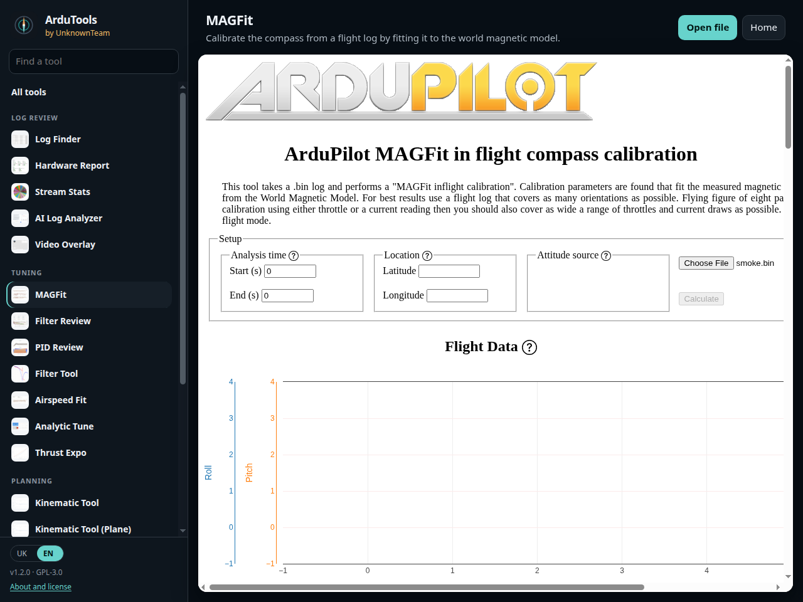
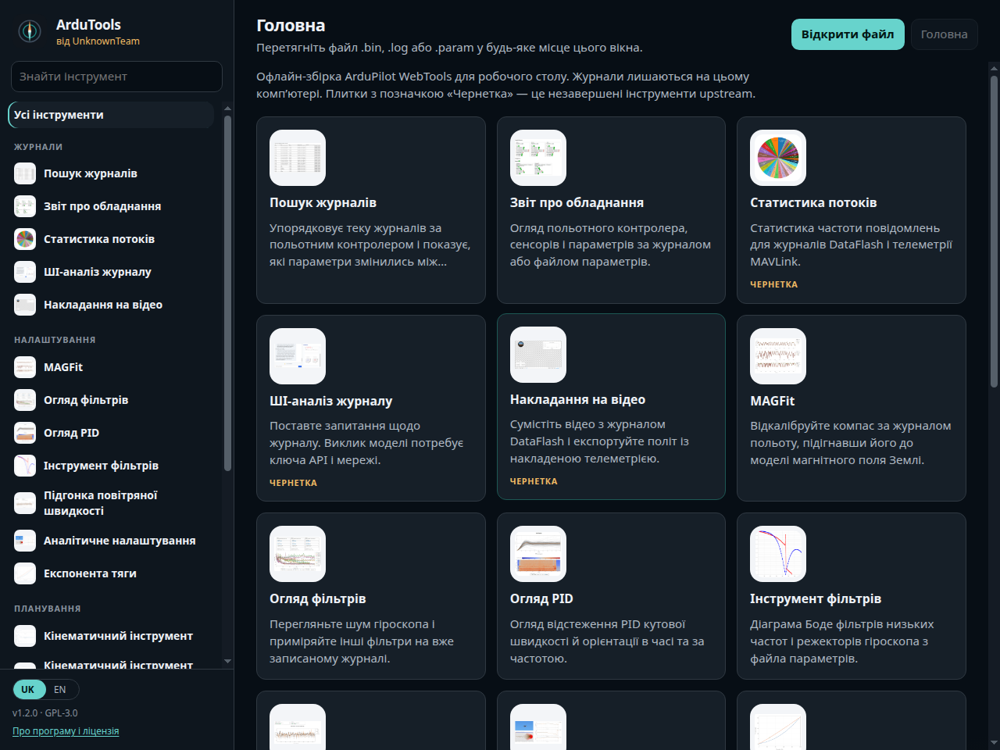

# ArduTools

ArduTools by UnknownTeam is an offline Windows desktop app for [ArduPilot WebTools](https://github.com/ArduPilot/WebTools). It packages MAGFit, Filter Review, PID Review, Hardware Report, and the rest of the upstream tools behind one dark home screen, and it installs with a normal Windows setup program.

The tools run on this computer. A flight log opened in ArduTools is not uploaded anywhere.




## Download and install

The Windows installer is attached to [GitHub Releases](https://github.com/Ispor4en/ArduTools/releases). For 1.2.0 the file is:

[ArduTools-Setup-1.2.0.exe](https://github.com/Ispor4en/ArduTools/releases/download/v1.2.0/ArduTools-Setup-1.2.0.exe)

1. Download `ArduTools-Setup-1.2.0.exe`.
2. Run the installer. It is not code-signed, so Windows SmartScreen may ask you to choose **More info** and then **Run anyway**. The installer asks for a language and preselects Ukrainian when the Windows display language is Ukrainian, otherwise English. The NSIS pages (folder, shortcuts, uninstall) follow that choice.
3. Choose an install folder if you want one. The default is a per-user install.
4. Leave **Desktop shortcut** and **Start Menu shortcut** selected. The shortcut name is **ArduTools**.
5. Open **ArduTools** from the desktop or the Start Menu.

To remove it, use **Settings → Apps → ArduTools by UnknownTeam**, or the uninstaller in the Start Menu folder.

## Using the app

The home screen is a tile for every tool shipped in ArduPilot WebTools `main`, including the upstream work-in-progress tools (marked **Preview** / **Чернетка**). The sidebar switches tools without leaving the app. **File → Open file** and the **Open file** button use the normal Windows file picker.

The shell is in English or Ukrainian. **UK** and **EN** in the sidebar switch the language and remember the choice. On a new install, Ukrainian Windows (`uk` / `uk-UA`) opens in Ukrainian; every other locale opens in English. MAGFit, Filter Review, PID Review, and Hardware Report also get a light label translation (buttons, section titles, legends) injected at runtime. The upstream files are not edited, so a WebTools sync does not drop the translation. Longer instructions and the other tools stay in the upstream language.

Drop a file anywhere on the window:

| File | Opens in |
| --- | --- |
| `.bin` | MAGFit. Buttons on the bar offer Filter Review, PID Review, Hardware Report, and the other log tools. If you are already in a tool that accepts `.bin`, the file stays there. |
| `.param`, `.parm` | Hardware Report, with Filter Tool and Thrust Expo as alternates. |
| `.tlog` | Stream Stats |
| `.log` | AI Log Analyzer |
| a video | Video Overlay |

Log Finder still scans a whole folder from its own **Search directory** button. That picker works inside the app.

### MAGFit

1. Open **MAGFit**.
2. Load a `.bin` log, or drop the file on the window.
3. Set the analysis window, location, and attitude source. A log with turns and a range of throttle is the useful case.
4. Calculate, read the compass fit, and save the parameters you want to put on the vehicle.

### Filter Review, PID Review, and Hardware Report

- **Filter Review** plots gyro noise from batch or raw IMU logs and shows what a different filter setup would have done.
- **PID Review** shows rate and attitude tracking in time and frequency. Enable the `PID` bit of `LOG_BITMASK` before the flight when you want every PID term; `RATE` is logged by default.
- **Hardware Report** reads a `.bin` log or a `.param` / `.parm` file and summarizes the controller, sensors, and parameters.

The other tiles are the rest of the upstream catalog: Filter Tool, Airspeed Fit, Analytic Tune, Thrust Expo, Log Finder, Stream Stats, AI Log Analyzer, Video Overlay, the kinematic tools, SCurve, Rotation Check, Geofence Generator, SysID, Telemetry Dashboard, Simple GCS, and DFU Loader. Each page is the upstream tool, unchanged, served inside the app over `http://127.0.0.1`.

## What stays offline, and what still needs a network

The tool pages, Plotly, the DataFlash parser, and the libraries those pages load are inside the install. You can open every tool with the network disconnected.

A few upstream features call out by design:

- Map tiles and OpenStreetMap searches (Geofence Generator, Log Finder’s map, Simple GCS, some telemetry widgets).
- SysID ships the Pyodide runtime. Installing `matplotlib` and `python-control` still uses the network the first time you run an identification.
- AI Log Analyzer sends the conversation to the model API you configure. That call needs a network and a key.
- Telemetry Dashboard and Simple GCS expect a live MAVLink WebSocket on this machine (Mission Planner’s forwarder, or an equivalent). Simple GCS reads `SimpleGCS/config.example.js` when you have not added your own `config.js`.
- DFU Loader needs a board already in USB DFU mode.
- [UAV Log Viewer](https://plot.ardupilot.org/) is a separate ArduPilot project and is not part of this install.

## Build from source

Requirements: Git, Node.js 22 or newer. The Windows installer is built on Windows. `npm start` also runs on Linux and macOS for development.

```bash
git clone --recurse-submodules https://github.com/Ispor4en/ArduTools.git
cd ArduTools
npm ci
npm run sync
npm start
```

`npm run sync` reads the pinned [ArduPilot/WebTools](https://github.com/ArduPilot/WebTools) submodule and downloads only the browser files the tools request (Plotly’s minified build, JsDataflashParser, fft.js, Tabulator, and the CDN scripts). It does not clone the full Plotly or ArduPilot firmware trees.

On Windows, the installer is:

```bat
npm run dist
```

The setup program is written to `dist/ArduTools-Setup-1.2.0.exe`.

## Keyboard

- **Arrow keys** move through the sidebar list and, separately, through the tool tiles.
- **Enter** opens the focused tool.
- **/** or **Ctrl+K** focuses the tool search. Typing filters the list and the tiles.
- **Esc** clears the search, or leaves the open tool and returns focus to the tile you opened.

Checks:

```bash
npm test
npm run smoke
```

`npm run smoke` needs a display (or `xvfb-run` on Linux). It opens every tool offline and drops a sample file into MAGFit.

### Upstream updates

WebTools is the git submodule `upstream/WebTools`, pinned in `upstream/UPSTREAM.json`. A weekly GitHub Action compares that pin with `ArduPilot/WebTools` `main` and opens a pull request when the upstream branch moves. After merging that pull request, run `npm run sync` before the next release build.

## Credits and license

ArduTools is an independent packaging project by UnknownTeam. It is not an official ArduPilot release.

The tools themselves are **ArduPilot WebTools**, GPL-3.0, by the ArduPilot WebTools authors:

- Project: <https://github.com/ArduPilot/WebTools>
- Live copy and docs: <https://firmware.ardupilot.org/Tools/WebTools/>
- Authors: <https://github.com/ArduPilot/WebTools/graphs/contributors>

Their license ships in this repository at `upstream/WebTools/LICENSE` and inside the installed app. Third-party libraries (Plotly, JsDataflashParser, fft.js, Tabulator, Leaflet, and the other packages fetched by `scripts/sync-upstream.mjs`) keep their own license terms.

ArduTools as a whole is distributed under the GNU General Public License, version 3. See [LICENSE](LICENSE) and [NOTICE](NOTICE). You can redistribute it and change it under those terms. Source for the shell is this repository; source for the tools is the WebTools submodule at the commit recorded in `upstream/UPSTREAM.json`.

---

# ArduTools (українською)

ArduTools від UnknownTeam — це офлайн-застосунок Windows для [ArduPilot WebTools](https://github.com/ArduPilot/WebTools). Він збирає MAGFit, Filter Review, PID Review, Hardware Report і решту інструментів з upstream в один темний домашній екран і ставиться звичайним інсталятором Windows.

Інструменти працюють на цьому комп’ютері. Журнал польоту, відкритий в ArduTools, нікуди не відправляється.


## Завантаження та встановлення

Інсталятор Windows додається до [релізів на GitHub](https://github.com/Ispor4en/ArduTools/releases). Для версії 1.2.0 це файл:

[ArduTools-Setup-1.2.0.exe](https://github.com/Ispor4en/ArduTools/releases/download/v1.2.0/ArduTools-Setup-1.2.0.exe)

1. Завантажте `ArduTools-Setup-1.2.0.exe`.
2. Запустіть інсталятор. Файл не підписаний цифровим підписом, тож SmartScreen може попросити натиснути **Докладніше**, а потім **Виконати попри це**. Інсталятор запитує мову і наперед обирає українську, якщо мова Windows — українська; інакше англійську. Сторінки NSIS (тека, ярлики, видалення) показуються цією мовою.
3. За бажанням оберіть теку встановлення. Типово програма ставиться для поточного користувача.
4. Залиште позначки ярлика на робочому столі та в меню «Пуск». Назва ярлика — **ArduTools**.
5. Відкрийте **ArduTools** з робочого столу або меню «Пуск».

Щоб видалити програму, відкрийте **Параметри → Програми → ArduTools by UnknownTeam** або деінсталятор у теці меню «Пуск».

## Як користуватися

На домашньому екрані є плитка кожного інструмента з гілки `main` ArduPilot WebTools, разом із незавершеними інструментами upstream (позначка **Preview** / **Чернетка**). Бічна панель перемикає інструменти, не закриваючи застосунок. **Файл → Відкрити файл** і кнопка **Відкрити файл** відкривають звичайне вікно вибору файла Windows.

Оболонка українською або англійською. Кнопки **UK** і **EN** у бічній панелі перемикають мову і запам’ятовують вибір. На новій установці українська Windows (`uk` / `uk-UA`) відкривається українською; будь-яка інша локаль — англійською. MAGFit, Огляд фільтрів, Огляд PID і Звіт про обладнання додатково отримують легкий переклад підписів (кнопки, заголовки розділів, групи полів). Його вставлено під час показу сторінки, файли upstream не змінюються, тож синхронізація WebTools переклад не затирає. Довгі пояснення та решта інструментів лишаються мовою upstream.



Перетягніть файл у будь-яке місце вікна:

| Файл | Куди відкривається |
| --- | --- |
| `.bin` | MAGFit. На панелі внизу є кнопки Filter Review, PID Review, Hardware Report та інших інструментів для журналів. Якщо вже відкрито інструмент, який приймає `.bin`, файл лишається в ньому. |
| `.param`, `.parm` | Hardware Report; додатково Filter Tool і Thrust Expo. |
| `.tlog` | Stream Stats |
| `.log` | AI Log Analyzer |
| відео | Video Overlay |

Log Finder як і раніше переглядає цілу теку власною кнопкою **Search directory**. Цей вибір теки працює всередині застосунку.

### MAGFit

1. Відкрийте **MAGFit**.
2. Завантажте журнал `.bin` або перетягніть файл у вікно.
3. Задайте вікно аналізу, місце і джерело орієнтації. Корисний журнал містить розвороти і різний газ.
4. Порахуйте підгонку компаса і збережіть параметри, які треба записати на борт.

### Filter Review, PID Review і Hardware Report

- **Filter Review** показує шум гіроскопа з пакетних або сирих логів IMU і те, що змінилось би з іншим налаштуванням фільтрів.
- **PID Review** показує відстеження кутової швидкості і орієнтації в часі та за частотою. Щоб бачити всі складові PID, перед польотом увімкніть біт `PID` у `LOG_BITMASK`; повідомлення `RATE` пишеться типово.
- **Hardware Report** читає журнал `.bin` або файл `.param` / `.parm` і зводить контролер, сенсори та параметри.

Решта плиток — це каталог upstream без переписування: Filter Tool, Airspeed Fit, Analytic Tune, Thrust Expo, Log Finder, Stream Stats, AI Log Analyzer, Video Overlay, кінематичні інструменти, SCurve, Rotation Check, Geofence Generator, SysID, Telemetry Dashboard, Simple GCS і DFU Loader. Кожна сторінка — це інструмент upstream, його код не змінювався; застосунок віддає його через `http://127.0.0.1`.

## Що працює офлайн, а що все ще хоче мережу

Сторінки інструментів, Plotly, розбір DataFlash і бібліотеки, які ці сторінки завантажують, входять до встановленої програми. Усі інструменти відкриваються без мережі.

Кілька можливостей upstream самі звертаються назовні:

- Тайли карти і пошук OpenStreetMap (Geofence Generator, карта Log Finder, Simple GCS, частина віджетів телеметрії).
- SysID містить середовище Pyodide. Пакети `matplotlib` і `python-control` під час першого розрахунку все одно завантажуються з мережі.
- AI Log Analyzer надсилає розмову до API моделі, яку ви налаштували. Для цього потрібні мережа і ключ.
- Telemetry Dashboard і Simple GCS чекають на живий WebSocket MAVLink на цьому комп’ютері (пересилання Mission Planner або аналог). Simple GCS читає `SimpleGCS/config.example.js`, якщо власного `config.js` немає.
- DFU Loader потребує плати, яка вже в режимі USB DFU.
- [UAV Log Viewer](https://plot.ardupilot.org/) — окремий проєкт ArduPilot, до цього встановлення він не входить.

## Збірка з вихідного коду

Потрібні Git і Node.js 22 або новіший. Інсталятор Windows збирається на Windows. `npm start` також запускається на Linux і macOS для розробки.

```bash
git clone --recurse-submodules https://github.com/Ispor4en/ArduTools.git
cd ArduTools
npm ci
npm run sync
npm start
```

`npm run sync` читає зафіксований підмодуль [ArduPilot/WebTools](https://github.com/ArduPilot/WebTools) і завантажує лише ті файли, які запитує браузер (зібраний Plotly, JsDataflashParser, fft.js, Tabulator і скрипти з CDN). Повні дерева вихідного коду Plotly і прошивки ArduPilot не клонуються.

На Windows інсталятор збирається так:

```bat
npm run dist
```

Програма встановлення з’являється як `dist/ArduTools-Setup-1.2.0.exe`.

## Клавіатура

- **Стрілки** рухають фокус списком у бічній панелі і, окремо, сіткою плиток.
- **Enter** відкриває інструмент у фокусі.
- **/** або **Ctrl+K** ставить курсор у пошук. Текст звужує список і плитки.
- **Esc** очищає пошук або закриває відкритий інструмент і повертає фокус на його плитку.

Перевірки:

```bash
npm test
npm run smoke
```

`npm run smoke` потребує дисплея (на Linux підійде `xvfb-run`). Скрипт відкриває кожен інструмент офлайн і кидає пробний файл у MAGFit.

### Оновлення upstream

WebTools підключено як підмодуль git `upstream/WebTools`. Коміт зафіксовано в `upstream/UPSTREAM.json`. Щотижнева дія GitHub порівнює цей коміт із гілкою `main` у `ArduPilot/WebTools` і відкриває pull request, коли upstream рухається. Після злиття того запиту перед наступним релізом запустіть `npm run sync`.

## Подяки та ліцензія

ArduTools — незалежне пакування від UnknownTeam. Це не офіційний випуск ArduPilot.

Самі інструменти — це **ArduPilot WebTools**, GPL-3.0, автори проєкту ArduPilot WebTools:

- Проєкт: <https://github.com/ArduPilot/WebTools>
- Жива копія і документація: <https://firmware.ardupilot.org/Tools/WebTools/>
- Автори: <https://github.com/ArduPilot/WebTools/graphs/contributors>

Їхня ліцензія лежить у цьому репозиторії в `upstream/WebTools/LICENSE` і входить до встановленої програми. Сторонні бібліотеки (Plotly, JsDataflashParser, fft.js, Tabulator, Leaflet та інші пакети, які забирає `scripts/sync-upstream.mjs`) зберігають власні умови ліцензій.

ArduTools загалом поширюється за GNU General Public License версії 3. Дивіться [LICENSE](LICENSE) і [NOTICE](NOTICE). Програму можна поширювати і змінювати на цих умовах. Вихідний код оболонки — цей репозиторій; вихідний код інструментів — підмодуль WebTools на коміті з `upstream/UPSTREAM.json`.
